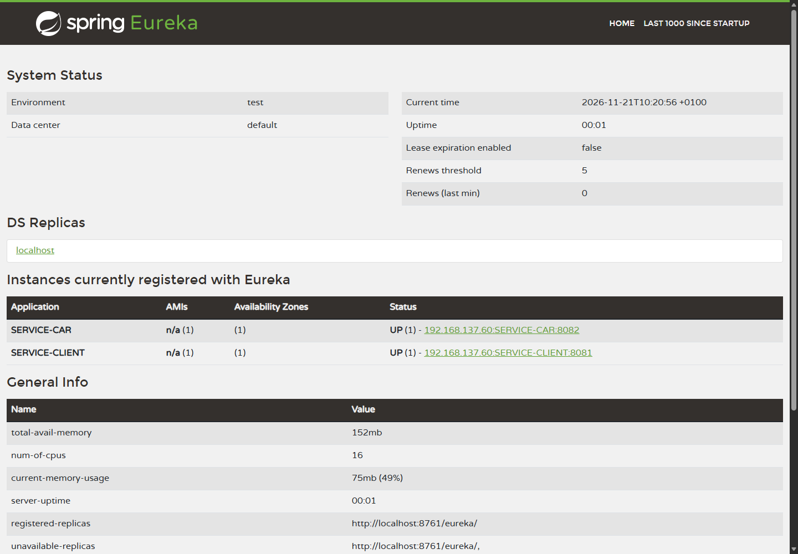
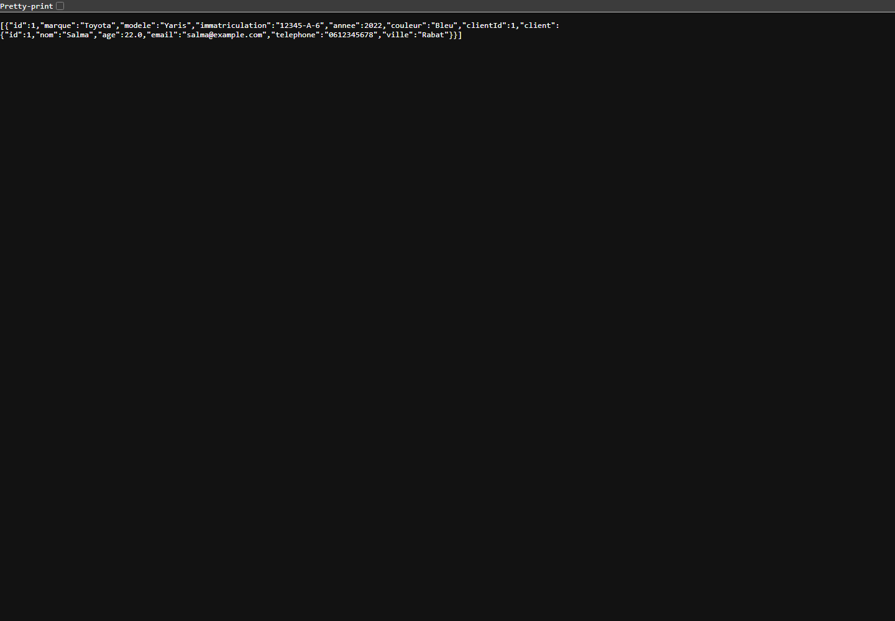

# TP - Microservices clients et voitures

Ce projet comprend un serveur Eureka et deux services Spring Boot utilisant des bases MySQL distinctes. Le service voiture retrouve les informations du client avec WebClient et Eureka.

Champs ajoutes : **email, telephone et ville** pour le client ; **immatriculation, annee et couleur** pour la voiture.

## Prerequis

- JDK 17 ou une version compatible superieure, Maven 3.6.3 ou superieur et MySQL demarre.
- Un compte MySQL autorise a creer des bases, ou les bases `clientservicedb` et `carservicedb` deja creees avec les droits necessaires.
- Postman ou un autre client HTTP ; les ports 8761, 8081 et 8082 doivent etre libres.

### Configurer Java pour Maven sous Windows

Spring Boot 3 utilise au minimum Java 17. Dans PowerShell, verifiez la version utilisee par Maven :

```powershell
mvn -v
```

La ligne `Java version` doit indiquer 17 ou plus. Si elle indique 11, installez un JDK 17 puis adaptez son chemin ci-dessous dans **chaque terminal** avant de lancer Maven :

```powershell
$env:JAVA_HOME = "C:\Program Files\Java\jdk-17"
$env:Path = "$env:JAVA_HOME\bin;$env:Path"
mvn -v
```

Remplacez le chemin par celui du JDK installe. Dans IntelliJ IDEA, choisissez aussi le JDK 17 pour le projet et pour Maven Runner. Les variables PowerShell ci-dessus ne durent que le temps de la session.

### Configurer MySQL

Par defaut, les services utilisent `root` avec un mot de passe vide sur `localhost:3306`. Dans chaque terminal utilise pour lancer un service JPA, adaptez ces variables si necessaire :

```powershell
$env:MYSQL_USER = "root"
$env:MYSQL_PASSWORD = "votre_mot_de_passe"
```

Ne deposez pas de mot de passe dans le depot. Adaptez les URL dans les fichiers `application.yml` si MySQL utilise un autre port.

## Tester avant le depot GitHub

Depuis la racine du projet, compilez les trois modules :

```powershell
mvn clean package
```

Ouvrez ensuite trois terminaux a la racine. Configurez Java et MySQL dans chaque terminal si necessaire, puis lancez les services dans cet ordre :

```powershell
mvn -f eureka-server/pom.xml spring-boot:run
```

Ouvrez http://localhost:8761, puis lancez :

```powershell
mvn -f service-client/pom.xml spring-boot:run
```

```powershell
mvn -f service-car/pom.xml spring-boot:run
```

Attendez l'apparition de `SERVICE-CLIENT` et `SERVICE-CAR` dans Eureka ; cela peut prendre quelques instants.

Dans Postman, envoyez les requetes suivantes avec `Content-Type: application/json` pour les POST :

1. `POST http://localhost:8081/api/clients`

   ```json
   { "nom": "Salma", "age": 22, "email": "salma@example.com", "telephone": "0612345678", "ville": "Rabat" }
   ```

   Notez l'`id` genere. Verifiez ensuite `GET http://localhost:8081/api/clients` et `GET http://localhost:8081/api/clients/1`, en remplacant `1` par cet id.

2. Verifiez l'appel entre services avec `GET http://localhost:8082/api/test/client/1`, en utilisant le meme id. Le JSON du client doit apparaitre.

3. `POST http://localhost:8082/api/cars` : remplacez `clientId` par l'id obtenu.

   ```json
   { "marque": "Toyota", "modele": "Yaris", "immatriculation": "12345-A-6", "annee": 2022, "couleur": "Bleu", "clientId": 1 }
   ```

4. Verifiez `GET http://localhost:8082/api/cars` puis `GET http://localhost:8082/api/cars/byClient/1` avec le bon id. Chaque voiture liee doit contenir un objet `client` avec ses champs. Une recherche de client inexistant retourne 404.

En cas d'echec, verifiez les identifiants et droits MySQL, les ports, la presence des deux services dans Eureka et le chemin appele. Si Eureka ne connait pas encore un service, patientez puis reessayez. La lecture d'une voiture dont le client est inexistant ou inaccessible echoue : ce TP ne gere pas encore ce cas de maniere specifique. `block()` est utilise ici pour simplifier le TP.

## Depot sur GitHub

Apres les verifications et l'ajout de vos captures, creez un depot vide sur GitHub puis, depuis la racine, adaptez l'URL :

```powershell
git init
git add .
git commit -m "Realiser le TP microservices"
git branch -M main
git remote add origin https://github.com/VOTRE_COMPTE/VOTRE_DEPOT.git
git push -u origin main
```

Si le dossier est deja un depot Git ou possede deja un remote `origin`, adaptez ces commandes a sa configuration.

## Captures d'execution

**Serveur Eureka : les deux services sont actifs**



**API voitures : resultat avec les informations du client**


